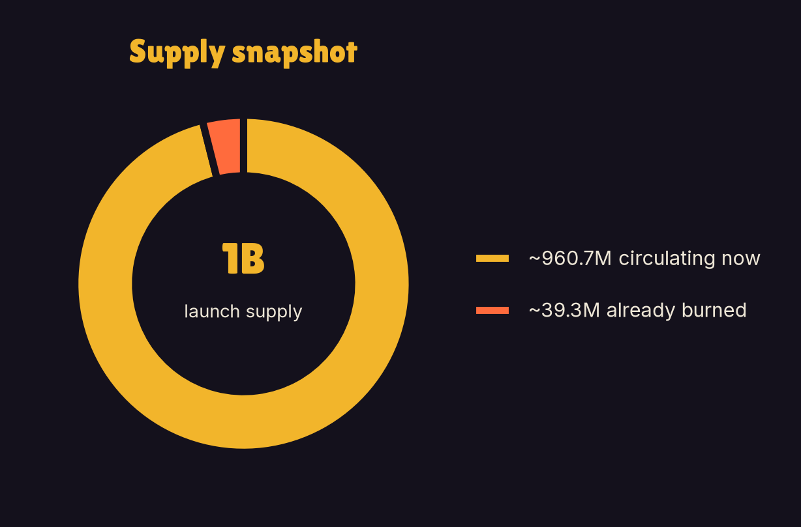
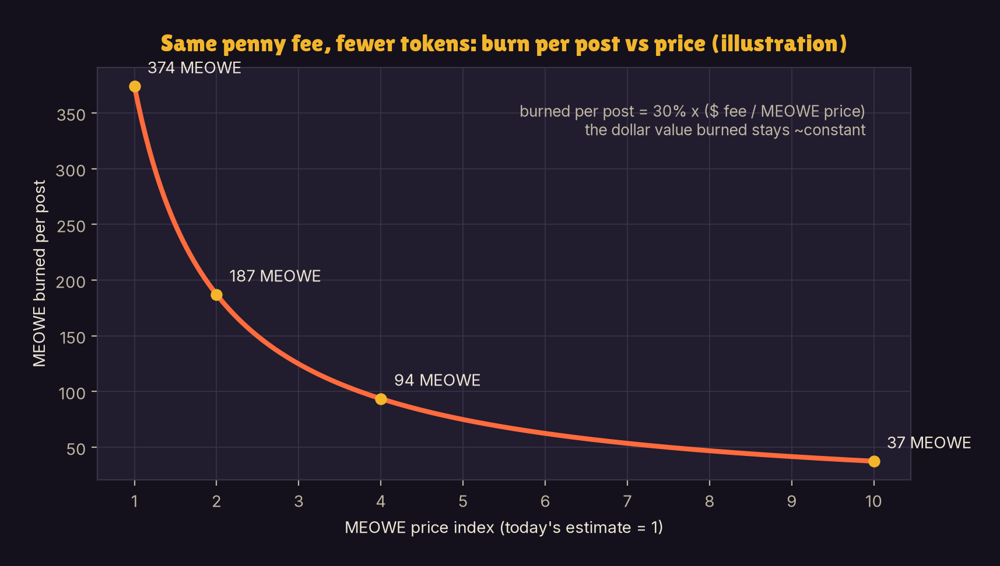
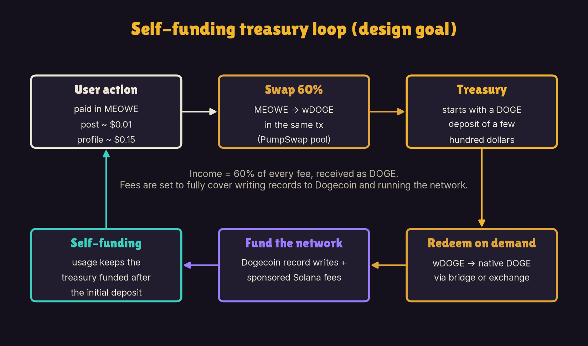
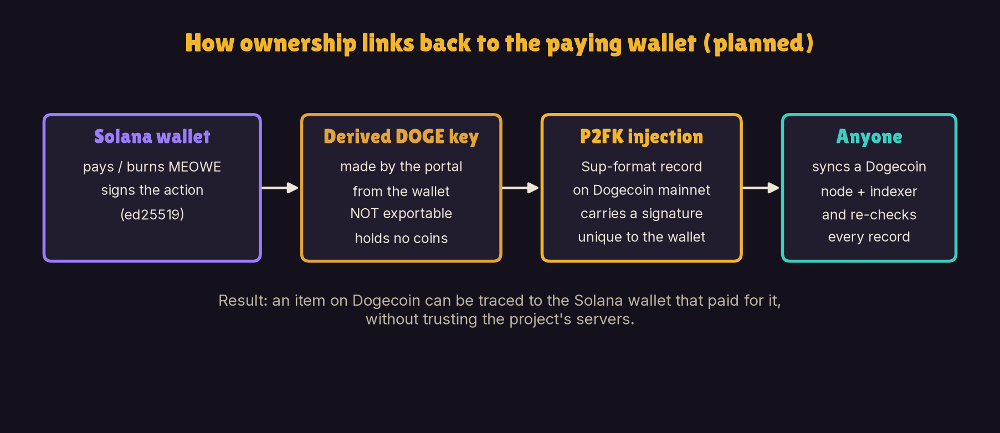
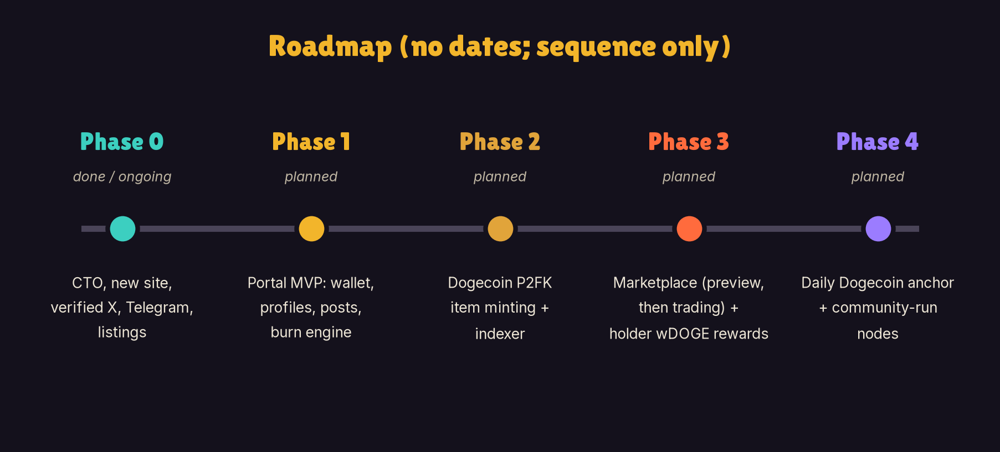

# Meowecoin (MEOWE) White Paper

*Memes are forever on Doge.*

Version 1.0 · October 2026 · Community edition

> **Status note.** MEOWE is live on Solana. The MEOWE Portal ("the forge"), the burn engine, the Dogecoin indexer, the marketplace and holder rewards in wDOGE are **planned and in development**. Nothing in this paper is a promise of features, timelines, returns or price. Illustrative numbers use today's estimated prices and are labeled as illustrations.

## 1. Abstract

Meowecoin (MEOWE) is a community-run meme token on Solana that started life as a reaction emoji in the DOGEos Discord server. After its original deployer abandoned it, the community took it over and is rebuilding it with a new website, a verified X account, a Telegram group and a product: the **MEOWE Portal**, nicknamed **"the forge"**.

The portal is planned as a place where memes and social content are made to last. Users get a portal-generated Solana wallet, mint a profile, post messages and memes, mint items and later trade them on a marketplace, paying only in MEOWE. Files live on IPFS. Small pointers to them are written to Solana. Profiles, items and ownership are written permanently to **Dogecoin mainnet** using Sup's P2FK (pay-to-fake-key) format, the same way Sup records data on Bitcoin.

Every action is priced in pennies and paid in MEOWE: a post costs about a penny (~$0.01) and creating a profile costs about $0.15. Of each fee, **30% is burned forever**, **60% is swapped to DOGE** to pay for Dogecoin records and fund the treasury, and **10% goes to community nodes** that pin files and run indexers. Separately, the PumpSwap creator fee is planned to go **100% to holders, paid in wDOGE**.

The design is simple to state: use creates demand for MEOWE, use burns MEOWE, and the records it creates sit on the oldest meme chain there is. Memes are forever on Doge.

## 2. Origin and lore

MEOWE did not start as a token. It started as a **reaction emoji in the DOGEos Discord server**, a cat face the community used to react to Doge memes. It spread the way good emojis do, and eventually it became a token.

The lore leans on two ideas:

- **The cat that sits next to the Doge.** MEOWE is a cat living in a Doge world. The main liquidity pool pairs MEOWE with wrapped DOGE, the planned holder rewards are paid in wDOGE, and the permanent records live on Dogecoin.
- **Nine lives.** Cats have nine lives, and so does MEOWE. Its first life ended when the original deployer walked away. Its second life is the community takeover. The branding uses the "9 lives" idea to say that a meme with a community behind it does not die when one person leaves.

## 3. Community takeover

MEOWE was launched on **pump.fun**. The original deployer launched it with **no website, no Telegram and no socials**, pumped it, dumped it, and abandoned it.

The holders who stayed decided to rebuild instead of walking away. This is a **community takeover (CTO)**. So far the community has:

- launched a new website, **meoweco.in**;
- set up a **verified X account, @1742Meowe**;
- opened a **Telegram community, t.me/meowecoinOG**;
- worked on listings and visibility;
- started building the **MEOWE Portal**, which is under construction.

There are **no team wallets and no vesting**. Nobody holds a reserved allocation waiting to unlock. The community owns the project because the community is all that is left, and that is the point.

## 4. The problem: memes are ephemeral or centralized

Memes are the culture of crypto, but where they live is fragile.

- **Social platforms own your posts.** Accounts get suspended, posts get deleted, platforms change rules or shut down. The meme you made can vanish, and you never really owned it.
- **Most chains are not built for history.** Fast chains are great for payments, but many nodes do not keep old transaction history forever. Data that only lives in old transactions can become hard to find.
- **"On-chain" art is often a link.** Many NFTs point to files on a single server. When the server goes, the art goes.
- **Meme tokens rarely do anything.** Most meme coins have no product, so there is no reason to hold or use them beyond speculation. When the hype fades, so does the token.

MEOWE's answer is to give the token a job: paying for a place where memes, profiles and items are recorded on a chain that keeps everything.

## 5. The solution: the MEOWE Portal ("the forge")

The MEOWE Portal is a web app, separate from the meoweco.in website, that is **in development**. Everything in this section is **planned**.

### What users will be able to do

| Feature | What it means | Where it is recorded |
|---|---|---|
| Wallet | A portal-generated Solana wallet, similar to SupSpace (supspace.io, built by embiimob) | Solana |
| Profiles | Mint a profile with a name, image and bio | Dogecoin mainnet (P2FK) + IPFS |
| Posts | Post messages and memes | Solana memo pointer + IPFS |
| Items | Mint memes and art as items you own | Dogecoin mainnet (P2FK) + IPFS |
| Marketplace | Browse items, later buy and sell | Preview first, then trading |

**One currency.** Every action is paid **only in MEOWE**. Users never need to hold DOGE or manage a Dogecoin wallet. The backend handles the burns, swaps and Dogecoin conversions behind the scenes.

**Why "the forge".** Content goes in as a file and comes out as a permanent record: forged onto Dogecoin, pinned on IPFS and paid for with MEOWE that is partly burned in the process.

## 6. Architecture

The portal uses three layers, each doing what it is best at: Solana for payments and pointers, IPFS for files and Dogecoin for permanent records.

**Solana: the payment and pointer layer.** Every portal action is one Solana transaction. It pays the fee in MEOWE, burns the burn share, swaps the swap share into wDOGE for the treasury, and attaches a memo. The memo is a small JSON pointer holding the IPFS CID (content ID) of the post or profile update.

**IPFS: the file layer.** Images, memes and JSON payloads live on IPFS. They are pinned by the project's own Kubo node plus public pinning services, and later by community nodes. A CID is a fingerprint of the content: if the file changes, the CID changes, so a CID recorded on chain proves exactly which file was meant.

**Dogecoin mainnet: the permanent record layer.** Profiles, items and ownership are written to Dogecoin using **Sup's P2FK (pay-to-fake-key)** structure, the same way Sup does on Bitcoin. P2FK encodes data into tiny unspendable outputs, so every Dogecoin full node keeps it forever.

**Our own Dogecoin indexer.** p2fk.io indexes Sup records on Bitcoin only, so the project runs its own Dogecoin indexer. It reads every Dogecoin block, rebuilds P2FK records with Sup's rules, and tells the portal who owns what.

**Linking Solana to Dogecoin.** Each Dogecoin P2FK injection carries a signature unique to the Solana wallet that paid or burned for it, so ownership links back to that wallet. The per-user Dogecoin key that signs these records is derived by the portal and is **not exportable, by design**.

**Phasing.** Phase 1 uses Solana memos plus IPFS CIDs for posts, with Dogecoin (via Sup's format) for objects. A **daily Dogecoin anchor**, one batch hash covering the day's Solana activity, is planned for later. The marketplace starts **preview-only**.

## 7. Tokenomics and supply

| Item | Detail |
|---|---|
| Name / ticker | Meowecoin / MEOWE |
| Chain | Solana (SPL token), launched on pump.fun |
| Contract address | `FiYTnrwt6CPmWQyWY4evBLK5Lu21jJSRHPYtX4Aepump` |
| Main pool | PumpSwap, MEOWE paired with wrapped DOGE (wDOGE) |
| Pool address | `5iQ5n8Sir2xKpGDJYcem5VxW6HVqUF6rkVyYeMepLs6u` |
| Launch supply | 1,000,000,000 MEOWE |
| Current supply | ~960.7M MEOWE (~39.3M already burned) |
| Team wallets | None |
| Vesting | None |

There is no reserved team or marketing allocation and nothing scheduled to unlock. Supply only goes one way: down, through burns.

## 8. Burn mechanics and the fee model

### 8.1 How an action is priced

Each portal action has a simple price in USD terms, converted to MEOWE at the moment of the action and paid in MEOWE. **A post costs about a penny** (~$0.01, about 1,246 MEOWE at today's estimated price), and **creating a profile costs pennies** (~$0.15, about 19,025 MEOWE). Every fee is split three ways:

- **30% burned forever.** Removed from supply permanently.
- **60% swapped to DOGE.** Pays for Dogecoin injections and funds the treasury.
- **10% to community nodes.** Pays the people who run IPFS pinning and indexer nodes.

The treasury also sponsors users' Solana network fees, with an optional user-paid speedup for people who want faster processing.

### 8.2 What a burn looks like (illustration)

*Illustration at today's estimated prices. Not a projection.*

| Action | Fee | MEOWE burned |
|---|---|---|
| One post | ~1,246 MEOWE (~$0.01) | ~374 MEOWE |
| One profile mint | ~19,025 MEOWE (~$0.15) | ~5,700 MEOWE |
| 1,000 posts a day | ~1.25M MEOWE a day | ~374K a day, ~136M a year |

At 1,000 posts a day, about **136M MEOWE a year** would be burned, roughly **14% of the current ~960.7M supply**. Each user only burns pennies' worth, but it adds up across the community.

### 8.3 Fees are priced in pennies, not tokens

This is the key mechanic. A post costs about a penny whether MEOWE is cheap or expensive. So the **number of tokens** burned per action depends on price:

> **tokens burned per action = 30% × (fee in dollars ÷ MEOWE price)**

If MEOWE's price rises, the same penny fee burns fewer tokens: at ten times today's price, a post would burn about 37 MEOWE instead of 374. The dollar value burned stays the same.

Now put that together with steady usage and steady demand (a roughly constant market cap). As supply shrinks, each token is worth a little more, so each action burns a little less. The result is that the burn removes a **roughly constant share of the remaining supply** each year, about 14% a year in the illustration, rather than a fixed number of tokens:

> **supply after t years = today's supply × (1 − 0.14)^t**

Supply keeps falling but **never reaches zero**. Mathematically this is geometric decay.

| Year (illustration) | 0 | 1 | 2 | 5 | 10 |
|---|---|---|---|---|---|
| Supply (M MEOWE) | 960.7 | ~826 | ~711 | ~452 | ~213 |

*These figures only show the shape of the curve under fixed assumptions. Real usage, prices and demand will differ, and could be far lower.*

### 8.4 Being honest about what burns do

Market cap equals price times supply. Burning tokens **does not by itself raise market cap**: if supply falls and nothing else changes, each token is worth a bit more and the total stays the same. The value case for MEOWE is not "burns make number go up". It is:

1. **Use requires MEOWE.** Every portal action is paid in MEOWE, so using the portal means buying MEOWE. That is real buy pressure tied to real use.
2. **Burns concentrate ownership.** Each burn makes every remaining token a slightly bigger share of the network.

Neither point is a promise of returns. If nobody uses the portal, neither effect happens.

## 9. Holder rewards in DOGE

MEOWE trades in a PumpSwap pool paired with wrapped DOGE. PumpSwap pays a **creator fee** on trading in that pool. The community plans to send **100% of that creator fee to MEOWE holders, paid in wDOGE**.

- **Status: planned / rolling out.** This is not yet confirmed live. Details such as eligibility, frequency and distribution method will be published by the community before or as it goes live.
- **Separate from the portal treasury.** The creator fee goes to holders, not to the treasury. The treasury runs only on its share of portal fees and its starting deposit.
- **Paid in wDOGE.** Holders of a cat token get paid in Doge, which keeps MEOWE tied to the Dogecoin community it came from.

Rewards depend on trading activity in the pool and can be small or zero. They are not interest, yield or a guaranteed income.

## 10. Treasury sustainability

The treasury keeps the portal running: it funds writing records to Dogecoin and sponsors users' Solana fees. It is designed to fund itself from usage instead of from a large war chest.

- **Starting deposit.** The treasury starts with a DOGE deposit of a few hundred dollars.
- **Income.** 60% of every fee is swapped to DOGE inside the user's own transaction, so the treasury receives DOGE, not MEOWE.
- **What it funds.** Writing records to Dogecoin and sponsored Solana fees.
- **Self-funding.** Fees are set to fully cover writing records to Dogecoin and running the network, so the treasury funds itself from usage after the initial deposit.
- **wDOGE to DOGE.** Swaps produce wrapped DOGE on Solana. The treasury redeems it to native DOGE **on demand**, through a bridge or an exchange, when it needs to pay for Dogecoin records.

If prices or network fees change, the fee in MEOWE adjusts, because the price of each action is set in USD or DOGE terms.

## 11. Security and verifiability

**Anyone can check.** Profiles, items and ownership live on Dogecoin mainnet. Anyone can verify marketplace objects by syncing a Dogecoin node and running the indexer. You do not need to trust the project's servers.

**Ownership traces back to the payer.** Every Dogecoin P2FK injection carries a signature unique to the Solana wallet that paid or burned for it, so an item on Dogecoin can be traced to the wallet that created it.

**Non-exportable Dogecoin key.** The per-user Dogecoin key is derived by the portal, only signs records, never holds coins, and cannot be exported. This keeps a user's Dogecoin identity bound to their Solana wallet.

**Files are pinned in more than one place.** IPFS content is pinned by the project's own Kubo node plus public pinning services, with community nodes planned to add more copies.

**Atomic payments.** Burn, swap and memo happen in one Solana transaction. If the swap price moves too far, the transaction fails and nothing is charged.

**Known risks the design must manage.** A browser wallet is only as safe as the user's password and the code the site serves. The relayer's Dogecoin key holds real funds, so only an operating float should be kept online. Redeeming wDOGE depends on bridge smart contracts and signers. No third-party audit has been announced; treat all code as unaudited until one is published.

## 12. Roadmap

| Phase | Scope | Status |
|---|---|---|
| Phase 0 | Community takeover, new site, verified X, Telegram, listings | Done / ongoing |
| Phase 1 | Portal MVP: wallet, profiles, posts, burn engine | Planned |
| Phase 2 | Dogecoin P2FK item minting + the Dogecoin indexer | Planned |
| Phase 3 | Marketplace (preview first, then trading) + holder wDOGE rewards | Planned |
| Phase 4 | Daily Dogecoin anchor + community-run nodes | Planned |

## 13. Community and links

MEOWE is a community takeover: no company, no team allocation, just holders who decided to build. Join in here:

| Channel | Link |
|---|---|
| Website | meoweco.in |
| X (verified) | @1742Meowe (x.com/1742Meowe) |
| Telegram | t.me/meowecoinOG |
| Contract address | `FiYTnrwt6CPmWQyWY4evBLK5Lu21jJSRHPYtX4Aepump` |
| PumpSwap pool (MEOWE/wDOGE) | `5iQ5n8Sir2xKpGDJYcem5VxW6HVqUF6rkVyYeMepLs6u` |

**Always check the contract address** before buying; the only official links are the ones above. Ways to help: make memes, share them, run a node when community nodes open up, and give feedback on the portal.

## 14. Disclaimer

**Not financial advice.** This white paper is for information and community discussion only. It is not financial, investment, legal or tax advice, and it is not an offer or solicitation to buy or sell any token or security. **Do your own research (DYOR)** and talk to a qualified professional before making any decision.

**No promises.** Nothing here promises returns, profits, price levels, price targets, listings, partnerships or delivery dates. Illustrative figures are based on today's estimated prices and simple assumptions. They are not projections and actual results may be very different.

**Risks.** Buying, holding or using MEOWE involves serious risk, including:

- **Meme-token volatility.** MEOWE's price can rise or fall sharply, and you can lose all of the money you put in. Liquidity can be thin.
- **Development risk.** The MEOWE Portal is **not live**. The portal, burn engine, indexer, marketplace and holder rewards are planned and may be delayed, changed, reduced or never delivered.
- **Holder rewards are not confirmed live.** Rewards depend on trading activity and may be small, irregular or zero.
- **Smart-contract and bridge risk.** wDOGE is a wrapped asset that depends on bridge smart contracts and signers. A bug, hack, pause or failure could make wDOGE impossible to redeem or worthless. Pools, programs and wallets can also contain bugs.
- **Technology risk.** Solana, Dogecoin, IPFS and pinning services can suffer outages, fee spikes or changes. Content stays available only while someone pins it.
- **Wallet and key risk.** Lost passwords, phishing or malicious code can mean lost access or stolen funds. The portal's derived Dogecoin key cannot be exported.
- **Regulatory uncertainty.** Laws on crypto assets, rewards and node payments are unclear and changing in many countries. Future rules could restrict MEOWE, the portal or rewards.
- **Community-run project.** MEOWE is a community takeover with no company behind it. Plans depend on volunteers and may change.

Only use money you can afford to lose. By interacting with MEOWE you accept these risks.

*Memes are forever on Doge.*
