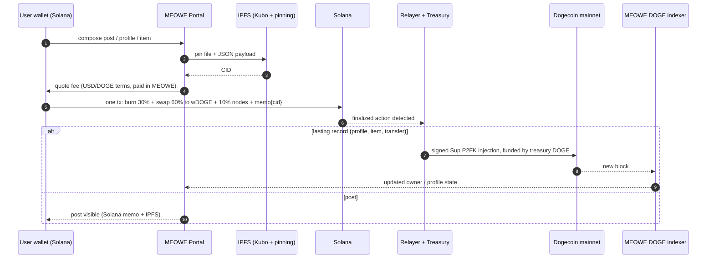

# Meowecoin (MEOWE): Technical Overview

*Architecture, data flow and fee mechanics of the MEOWE Portal ("the forge"). Version 1.0, October 2026.*

**Audience:** developers and technical investors. **Status:** the MEOWE Portal is **in development**. Everything in this document about the portal, the burn engine, the indexer, the marketplace and holder rewards describes the **planned** design, not a live system. Numbers marked *illustration* use today's estimated prices and are not projections.

| Item | Value |
|---|---|
| Token | MEOWE (SPL token on Solana), launched on pump.fun |
| Contract address (mint) | `FiYTnrwt6CPmWQyWY4evBLK5Lu21jJSRHPYtX4Aepump` |
| Main pool | PumpSwap MEOWE / wDOGE: `5iQ5n8Sir2xKpGDJYcem5VxW6HVqUF6rkVyYeMepLs6u` |
| Supply | 1,000,000,000 at launch; ~960.7M now (~39.3M burned). No team wallets, no vesting |
| Links | meoweco.in · X @1742Meowe · t.me/meowecoinOG |

## 1. System overview

The portal is a separate web app from meoweco.in. It lets holders create profiles, post messages and memes, mint items and later trade them, paying **only in MEOWE**. Four layers do the work:

| Layer | Role |
|---|---|
| **Solana** | Payment layer. Every action is one Solana transaction that pays the MEOWE fee, burns the burn share, swaps the swap share to wDOGE for the treasury, and carries an SPL memo with a small JSON pointer (IPFS CID). |
| **IPFS** | Content layer. Files and JSON payloads, pinned by the project's own Kubo node plus public pinning services. |
| **Dogecoin mainnet** | Permanent record layer for profiles, items and ownership, written in Sup's P2FK (pay-to-fake-key) format, the same way Sup writes records to Bitcoin. |
| **Backend** | Relayer (watches Solana, funds and broadcasts Dogecoin injections, sponsors Solana fees), treasury, and the project's own Dogecoin P2FK indexer. |


## 2. Wallet and identity

- **Portal wallet.** Each user gets a portal-generated Solana wallet, in the style of SupSpace (supspace.io, built by embiimob): the key is created and encrypted in the browser. Per the design notes, connecting an existing wallet is also supported.
- **Derived Dogecoin key.** The portal derives a per-user Dogecoin signing key from the user's Solana wallet. It only signs P2FK records and never holds coins. **It is not exportable, by design**, so a Dogecoin identity cannot be separated from the Solana wallet that owns it.
- **Ownership link.** Each Dogecoin P2FK injection carries a signature unique to the Solana wallet that paid or burned for it. Anyone can therefore trace an item on Dogecoin back to the paying Solana wallet and check that the Solana payment really happened.

## 3. Data flow of one action




1. **Compose and pin.** The portal uploads the file and a JSON payload to IPFS and gets a CID.
2. **Quote.** The fee is computed in USD or DOGE terms and converted to MEOWE at the current pool price.
3. **One Solana transaction.** The user signs a single transaction containing the MEOWE burn, the swap of the swap share into wDOGE paid to the treasury (with a minimum-output guard, so if the price moves too far the transaction fails and nothing is charged), the node share, and an SPL memo. The memo holds a small JSON pointer, for example (illustrative format): `{"v":1,"t":"post","id":"<action-id>","cid":"bafy..."}`.
4. **Relay.** The relayer watches Solana for finalized portal actions. Posts and profile updates are complete at this point (Solana memo + IPFS CID). For lasting records (profiles, items, ownership changes) it builds a Sup-format P2FK transaction signed by the user's derived Dogecoin key, funds it from treasury DOGE, and broadcasts it to Dogecoin mainnet.
5. **Index.** The project's Dogecoin indexer reads every block, rebuilds P2FK messages using Sup's rules, and serves the current state ("what does this address own?") back to the portal.

## 4. The Dogecoin record layer (P2FK)

- **How P2FK stores data.** A message is cut into small pieces, each encoded as a "fake" destination address that receives a dust output. Those outputs can never be spent, so every Dogecoin full node keeps them forever. Sup reassembles the pieces in output order and verifies the signature at the front.
- **Why our own indexer.** p2fk.io indexes Sup records on Bitcoin only. The project therefore runs its own Dogecoin indexer that applies Sup's profile and object rules and answers the same kinds of queries. Community nodes can run the same indexer later.
- **Verifiability.** Anyone can verify marketplace objects and ownership by syncing a Dogecoin node and running the indexer; no trust in the project's servers is required.
- **Phasing.** Phase 1 uses Solana memo + IPFS CID, with Dogecoin (via Sup's format) for objects. A **daily Dogecoin anchor**, one batch hash of the day's Solana actions, comes later (Phase 4). The marketplace starts **preview-only**.

## 5. Fee mechanics

**Pricing.** Each action has a simple price in USD terms and is paid in MEOWE at the current price. A post costs about a penny (~$0.01, about 1,246 MEOWE at today's estimated price); creating a profile costs pennies (~$0.15, about 19,025 MEOWE).

```
fee_USD      = price of the action in USD   (post ≈ $0.01, profile ≈ $0.15)
fee_MEOWE    = fee_USD / P_MEOWE             (P_MEOWE = MEOWE price in USD at quote time)

burn         = 0.30 × fee_MEOWE   → burned forever (sent to the burn, removed from supply)
swap         = 0.60 × fee_MEOWE   → swapped to wDOGE in the same tx → treasury
nodes        = 0.10 × fee_MEOWE   → community IPFS and indexer operators
```


**Treasury.** Treasury income is the 60% swap share of action fees plus a starting DOGE deposit of a few hundred dollars. (The PumpSwap creator fee is planned to go 100% to holders, so it is not treasury income.) The treasury funds the Dogecoin record writes and **sponsors users' Solana fees** by acting as fee payer, with an optional user-paid speedup. wDOGE is redeemed to native DOGE **on demand**, via bridge or exchange. Fees are set to fully cover writing records to Dogecoin and running the network, so the treasury funds itself from usage after the initial deposit.

**Illustration at today's estimated prices (not a projection):**

| Action | Fee | Burned (30%) |
|---|---|---|
| Post | ~1,246 MEOWE (~$0.01) | ~374 MEOWE |
| Profile mint | ~19,025 MEOWE (~$0.15) | ~5,700 MEOWE |
| 1,000 posts/day | ~1.25M MEOWE/day | ~374K/day ≈ 136M/yr ≈ 14% of ~960.7M |

## 6. Burn dynamics: fees in pennies, not tokens

Fees are fixed in **dollars**, not in tokens. If daily usage is N actions with burn value b (USD) each:

```
tokens burned per year   B = 365 × N × b / P
if demand is steady, market cap M = P × S is roughly constant, so P = M / S
then  B / S = 365 × N × b / M = k        (a constant share of the remaining supply)
supply after t years     S_t = S_0 × (1 − k)^t      (illustration: k ≈ 0.14)
```

As supply shrinks and each token is worth more, each action burns **fewer** tokens. Under steady usage and demand the burn removes a roughly constant share of what remains: supply keeps falling but never reaches zero (geometric decay). At 14% a year the illustrative path is ~960.7M → ~452M after 5 years → ~213M after 10 years.


**Economic honesty.** Market cap = price × supply, so burning tokens does not by itself raise market cap. The value case is (1) using the portal requires buying MEOWE, which is buy pressure, and (2) burns make each remaining token a larger share of the network. No returns or price targets are implied.

## 7. Security and trust model

- **Verifiable records:** profiles, items and ownership live on Dogecoin mainnet and can be checked by anyone with a Dogecoin node and the indexer.
- **Atomic payment:** burn, swap and memo are in one Solana transaction with a slippage guard; it either all succeeds or nothing is charged.
- **Key design:** the derived Dogecoin key is non-exportable and signs only; browser-held wallets depend on the user's password and on the site serving clean code.
- **Treasury hot wallet:** the relayer needs a funded Dogecoin key; the design keeps only an operating float online.
- **wDOGE:** redeeming wrapped DOGE depends on bridge smart contracts and signers (bridge risk).
- **Pinning:** content stays available only while at least one node pins it; the project runs Kubo and uses public pinning services, and community nodes add redundancy later.

## 8. Roadmap (no dates)

| Phase | Scope | Status |
|---|---|---|
| 0 | Community takeover, new site, verified X, Telegram, listings | Done / ongoing |
| 1 | Portal MVP: wallet, profiles, posts, burn engine | Planned |
| 2 | Dogecoin P2FK item minting + Dogecoin indexer | Planned |
| 3 | Marketplace (preview first, then trading) + holder wDOGE rewards | Planned |
| 4 | Daily Dogecoin anchor + community-run nodes | Planned |

*Not financial advice. MEOWE is a highly volatile meme token; the portal is not live; wDOGE carries smart-contract and bridge risk; regulation is uncertain. Do your own research.*
