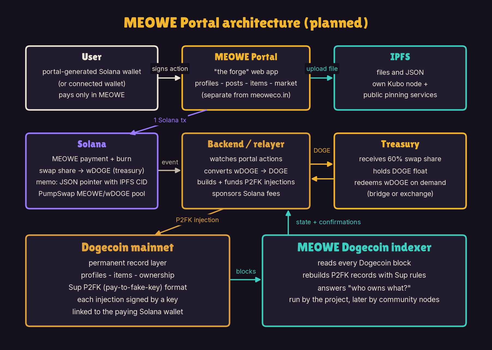
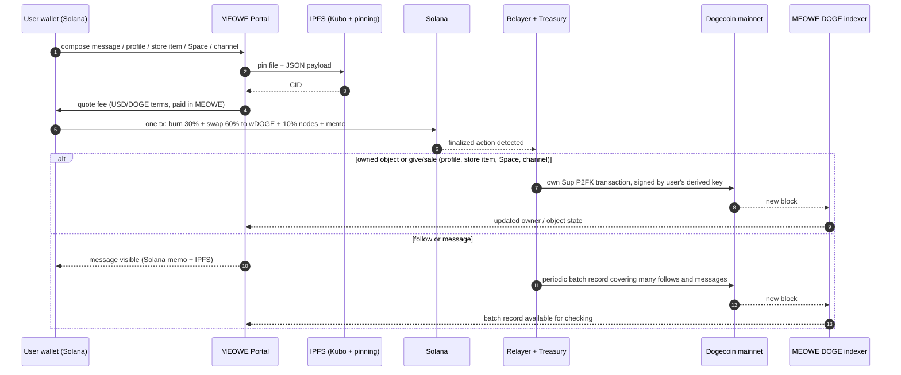
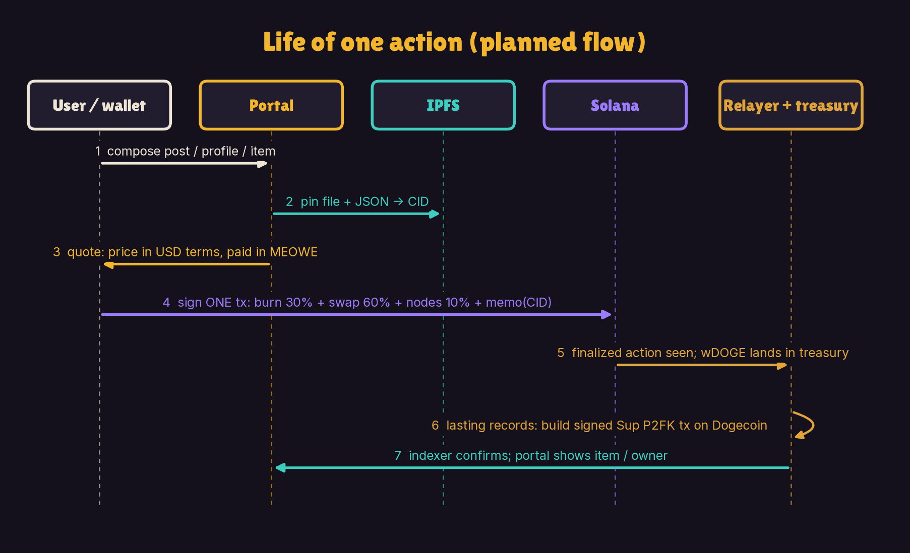
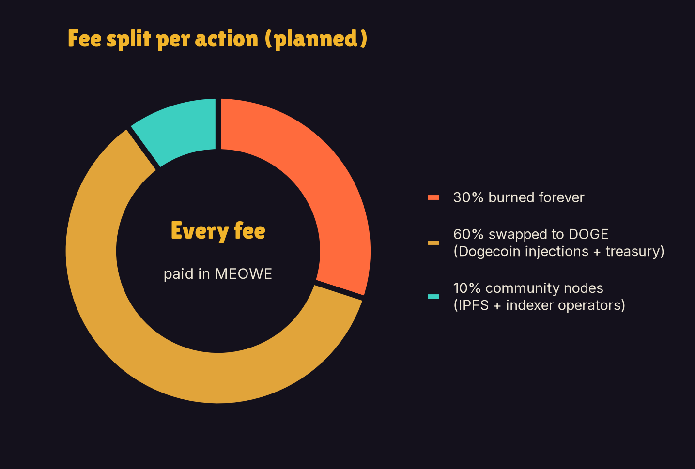
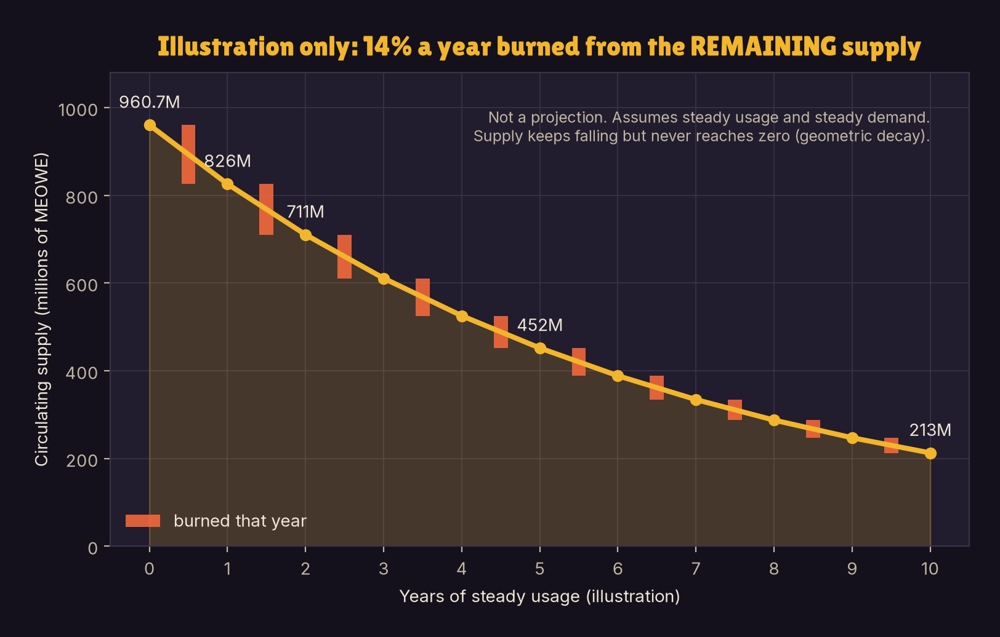

# Meowecoin (MEOWE): Technical Overview

*Decentralized content monetization, powered by $MEOWE. Architecture, data flow and fee mechanics of the MEOWE Portal ("the forge"). Version 1.1, October 2026.*

**Audience:** developers and technical investors. **Status:** the MEOWE Portal is **in development**. Everything in this document about the portal, the burn engine, the indexer, stores, Spaces and holder rewards describes the **planned** design, not a live system. Numbers marked *illustration* use today's estimated prices and are not projections.

| Item | Value |
|---|---|
| Token | MEOWE (SPL token on Solana), launched on pump.fun |
| Contract address (mint) | `FiYTnrwt6CPmWQyWY4evBLK5Lu21jJSRHPYtX4Aepump` |
| Main pool | PumpSwap MEOWE / wDOGE: `5iQ5n8Sir2xKpGDJYcem5VxW6HVqUF6rkVyYeMepLs6u` |
| Supply | 1,000,000,000 at launch; ~960.7M now (~39.3M burned). No team wallets, no vesting |
| Links | meoweco.in · X @1742Meowe · t.me/meowecoinOG |

## 1. System overview

The portal is a separate web app from meoweco.in. It lets holders create profiles, open a store and mint items into it, create Spaces with text channels, follow and message each other, and give away or sell what they own from their own store, paying **only in MEOWE**. Four layers do the work:

| Layer | Role |
|---|---|
| **Solana** | Payment layer. Every paid action is one Solana transaction that pays the MEOWE fee, burns the burn share, swaps the swap share to wDOGE for the treasury, and carries an SPL memo. For follows and messages, the memo is a small JSON pointer holding an IPFS CID. |
| **IPFS** | Content layer. Files and JSON payloads, pinned by the project's own Kubo node plus public pinning services. |
| **Dogecoin mainnet** | Ownership layer. Profiles, store items, Spaces and channels, and every give and sale, are each written as their own transaction in P2FK (Pay to Future Key), the record format of embii's Sup!? app, the same way Sup writes records to Bitcoin. Follows and messages are covered by a periodic batch record. |
| **Backend** | Relayer (watches Solana, builds and broadcasts Dogecoin records, writes the periodic batch record, sponsors users' Solana fees), treasury, and the project's own Dogecoin P2FK indexer. |



## 2. Wallet and identity

- **Portal wallet.** Each user gets a portal-generated Solana wallet, in the style of SupSpace (supspace.io, built by embiimob): the key is created and encrypted in the browser. Per the design notes, connecting an existing wallet is also supported.
- **Derived Dogecoin key.** The portal derives a per-user Dogecoin signing key from the user's Solana wallet. It only signs P2FK records and never holds coins. **It is not exportable, by design**, so a Dogecoin identity cannot be separated from the Solana wallet that owns it.
- **Ownership link.** Each Dogecoin P2FK injection carries a signature unique to the Solana wallet that paid or burned for it. Anyone can therefore trace an item on Dogecoin back to the paying Solana wallet and check that the Solana payment really happened.

## 3. Data flow of one action





1. **Compose and pin.** The portal uploads the file and a JSON payload to IPFS and gets a CID.
2. **Quote.** The fee is computed in USD or DOGE terms and converted to MEOWE at the current pool price.
3. **One Solana transaction.** The user signs a single transaction containing the MEOWE burn, the swap of the swap share into wDOGE paid to the treasury (with a minimum-output guard, so if the price moves too far the transaction fails and nothing is charged), the node share, and an SPL memo. For a follow or a message the memo holds a small JSON pointer, for example (illustrative format): `{"v":1,"t":"msg","id":"<action-id>","cid":"bafy..."}`.
4. **Relay.** The relayer watches Solana for finalized portal actions.
   - **Owned objects and gives/sales** (profiles, store items, Spaces, channels): it builds a Sup-format P2FK transaction signed by the user's derived Dogecoin key and broadcasts it to Dogecoin mainnet. Each is its own transaction.
   - **Follows and messages**: these are visible as soon as the Solana memo and IPFS CID exist. Periodically, the relayer writes one Dogecoin record (a Merkle root) that covers a whole batch of follows and messages. There is no per-message Dogecoin dust output.
   - **Private messages** are encrypted before they are pinned to IPFS and are covered by the same periodic batch. <!-- [CONFIRM] Private messages are batched like public messages. Owner to confirm before publishing. -->
   - **Exception: "Carve it on Doge"** (planned, optional, opt-in). A user can choose to write one message in full to Dogecoin as its own P2FK transaction, instead of leaving it only in the batch. Price: —.
5. **Index.** The project's Dogecoin indexer reads every block from block 0 (the first block), rebuilds P2FK records using Sup's rules, and serves the current state ("what does this address own?", "which channels belong to this Space?") back to the portal.

## 4. The Dogecoin record layer (P2FK)

- **How P2FK stores data.** A record is cut into small pieces, each encoded as a destination address that receives a dust output. No one holds a key for those addresses, so the outputs are never spent and every Dogecoin full node keeps them forever. Sup reassembles the pieces in output order and verifies the signature at the front.
- **Object fields.** Objects use the same fields as embii's Sup samples: `urn` (main file), `img`, `uri`, `nme` (name), `dsc` (description), `atr` (attributes), `lic` (license), `cre` (creators), `own` (owners), `roy` (royalties) and `max` (maximum supply).
- **Object address.** Every object's permanent address is its first creator address (`cre[0]`). Each object (profile, store item, Space, channel) has its own chat at that address, and a message can share any object as a card, picked from the user's store or pasted by address.
- **Spaces and channels.** A Space is an object with `lic` = `meowe:space`. A channel is an object with `lic` = `meowe:space:channel` and `uri` set to its Space's address. Only channels created by the Space's owner count as part of the Space. Giving or selling a Space moves its channels with it. Spaces are sold through the owner's store.
- **Why our own indexer.** p2fk.io indexes Sup records on Bitcoin only. The project therefore runs its own Dogecoin indexer that applies Sup's profile and object rules and answers the same kinds of queries. It runs on **Dogecoin Core 1.14.6 only**, because newer versions reorder `sendmany` outputs and P2FK depends on output order. Community nodes can run the same indexer later.
- **Verifiability.** Anyone can verify store items, Spaces, channels and ownership by syncing a Dogecoin node and running the indexer; no trust in the project's servers is required. A message can be checked against the periodic batch record that covers it.
- **Phasing.** Owned objects and every give and sale go to Dogecoin directly, each as its own transaction. Follows and messages are paid on Solana and recorded to Dogecoin in periodic batches. Selling starts in each owner's store; a shared marketplace across all stores comes later.
- **Kept off-chain (planned).** A minimal database holds only what the chains and IPFS cannot. "Recently viewed" profiles are stored on the user's device only.

## 5. Fee mechanics

**Pricing.** Each action has a simple price in USD terms and is paid in MEOWE at the current price. A message costs about a penny (~$0.01, about 1,246 MEOWE at today's estimated price); creating a profile costs pennies (~$0.15, about 19,025 MEOWE). Other actions (follows, store mints, Spaces, channels, gives, sales, "Carve it on Doge"): — (to be published).

```
fee_USD      = price of the action in USD   (message ≈ $0.01, profile ≈ $0.15)
fee_MEOWE    = fee_USD / P_MEOWE             (P_MEOWE = MEOWE price in USD at quote time)

burn         = 0.30 × fee_MEOWE   → burned forever (sent to the burn, removed from supply)
swap         = 0.60 × fee_MEOWE   → swapped to wDOGE in the same tx → treasury
nodes        = 0.10 × fee_MEOWE   → community IPFS and indexer operators
```



**Treasury.** Treasury income is the 60% swap share of action fees plus a starting DOGE deposit of a few hundred dollars. (The PumpSwap creator fee is planned to go 100% to holders, so it is not treasury income.) The treasury keeps the portal running and **sponsors users' Solana fees** by acting as fee payer, with an optional user-paid speedup. wDOGE is redeemed to native DOGE **on demand**, via bridge or exchange. After the initial deposit, the treasury is designed to run on its share of portal fees.

**Illustration at today's estimated prices (not a projection):**

| Action | Fee | Burned (30%) |
|---|---|---|
| Message | ~1,246 MEOWE (~$0.01) | ~374 MEOWE |
| Profile mint | ~19,025 MEOWE (~$0.15) | ~5,700 MEOWE |
| 1,000 messages/day | ~1.25M MEOWE/day | ~374K/day ≈ 136M/yr ≈ 14% of ~960.7M |

## 6. Burn dynamics: fees in pennies, not tokens

Fees are fixed in **dollars**, not in tokens. If daily usage is N actions with burn value b (USD) each:

```
tokens burned per year   B = 365 × N × b / P
if demand is steady, market cap M = P × S is roughly constant, so P = M / S
then  B / S = 365 × N × b / M = k        (a constant share of the remaining supply)
supply after t years     S_t = S_0 × (1 − k)^t      (illustration: k ≈ 0.14)
```

As supply shrinks and each token is worth more, each action burns **fewer** tokens. Under steady usage and demand the burn removes a roughly constant share of what remains: supply keeps falling but never reaches zero (geometric decay). At 14% a year the illustrative path is ~960.7M → ~452M after 5 years → ~213M after 10 years.



**Economic honesty.** Market cap = price × supply, so burning tokens does not by itself raise market cap. The value case is (1) using the portal requires buying MEOWE, which is buy pressure, and (2) burns make each remaining token a larger share of the network. No returns or price targets are implied. Owning a profile, store, Space or channel does not entitle anyone to a share of fees.

## 7. Security and trust model

- **Verifiable records:** profiles, store items, Spaces, channels and ownership live on Dogecoin mainnet and can be checked by anyone with a Dogecoin node and the indexer. Follows and messages can be checked against the periodic batch record.
- **Atomic payment:** burn, swap and memo are in one Solana transaction with a slippage guard; it either all succeeds or nothing is charged.
- **Key design:** the derived Dogecoin key is non-exportable and signs only; browser-held wallets depend on the user's password and on the site serving clean code.
- **Treasury hot wallet:** the relayer needs a funded Dogecoin key; the design keeps only an operating float online.
- **wDOGE:** redeeming wrapped DOGE depends on bridge smart contracts and signers (bridge risk).
- **Pinning:** content stays available only while at least one node pins it; the project runs Kubo and uses public pinning services, and community nodes add redundancy later.

## 8. Roadmap (no dates)

| Phase | Scope | Status |
|---|---|---|
| 0 | Community takeover, new site, verified X, Telegram, listings | Done / ongoing |
| 1 | Portal: wallet, profiles, store minting, Spaces and channels as Dogecoin P2FK objects + Dogecoin indexer from block 0 | Planned |
| 2 | Messages and follows paid in MEOWE, periodic Dogecoin batch records, object cards in messages, burn engine | Planned |
| 3 | Selling from each owner's store (including Spaces with their channels) + holder wDOGE rewards | Planned |
| 4 | Search (all, or "Mine" from wallet history), on-device "recently viewed", community-run nodes | Planned |
| Later | Shared marketplace across all stores; optional "Carve it on Doge" for single messages | Later |

*Not financial advice. MEOWE is a highly volatile meme token; the portal is not live; wDOGE carries smart-contract and bridge risk; regulation is uncertain. Do your own research.*
